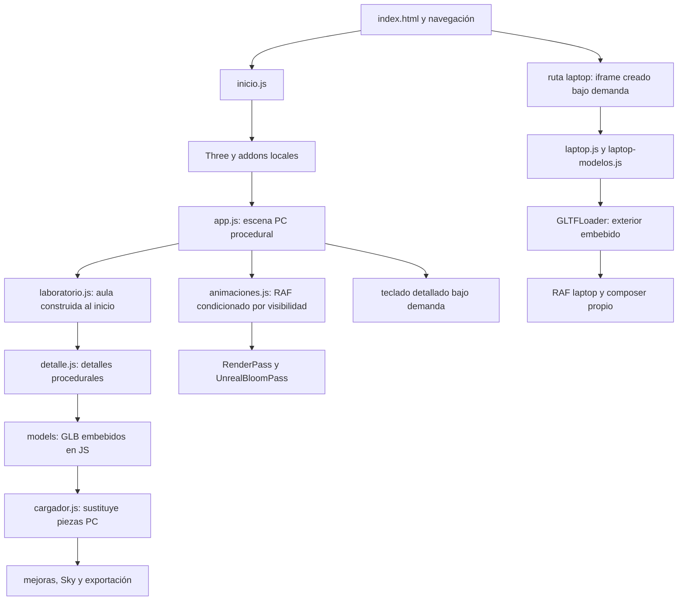

# Auditoría del simulador de ensamblaje 3D

Fecha: 14 de octubre de 2026. Alcance: diagnóstico previo a mejoras; no se modificaron la aplicación, los modelos, los audios ni las pruebas.

## Requisitos que guían el trabajo

El pedido actual es mejorar el proyecto según los documentos adjuntos. El prompt maestro se usa como especificación propuesta; el texto pegado contiene contexto y una conversación anterior, no órdenes nuevas. Se mantiene ejecución local con Python, recursos sin red en tiempo de ejecución, textos en español, Sky con MP3 locales, funciones existentes y atribuciones. Se prioriza una interfaz despejada sin cian/magenta decorativos. Las voces se dejan al final.

La auditoría precede a la implementación. Las direcciones «Manual de taller» y «Banco de trabajo» todavía son propuestas: la elección debe hacerse viendo las dos maquetas, no únicamente sus nombres.

## Versión y compatibilidad

Three.js es **r147**: aparece en el archivo vendorizado y se comprueba con `THREE.REVISION` en el navegador. Corresponden `renderer.outputEncoding`, `THREE.sRGBEncoding`, `texture.encoding`, `THREE.ACESFilmicToneMapping` y `renderer.physicallyCorrectLights`. No corresponde trasladar sin adaptación ejemplos de versiones recientes.

Los addons locales son OrbitControls, GLTFLoader, GLTFExporter, EffectComposer, RenderPass, ShaderPass, MaskPass, CopyShader, LuminosityHighPassShader y UnrealBloomPass. No exponen una revisión propia que permita fechar inequívocamente cada archivo; **no se afirma que todos sean exactamente r147**. Sus tamaños y SHA-256 están en [addons.json](auditoria/addons.json). La carga, el renderizado, la navegación y las exportaciones ejercitados durante el onboarding demostraron compatibilidad funcional en esos recorridos, no compatibilidad exhaustiva de todas sus APIs.

**Incompatibilidad concreta:** `app.js` (texturas de tablero y RGB), `cargador.js` (reflejo del vidrio) y `laboratorio.js` (madera) asignan `colorSpace = THREE.SRGBColorSpace`. En r147 esa constante no existe; la asignación no configura la codificación que usa esta versión. La corrección pertenece a la primera mejora de color.

## Flujo real de carga y renderizado

`inicio.js` inserta scripts dinámicos con `async=false`: preserva el orden de ejecución, pero las descargas pueden solaparse. La barra cuenta archivos terminados; **no es progreso en bytes ni progreso real de decodificación de modelos/texturas**.

`js/modelos.js` existe, pero no está en la lista actual de `inicio.js`: el cargador efectivo de PC es `cargador.js`. No conviene optimizar el archivo antiguo suponiendo que gobierna el render actual.

PC y su galería comparten renderer y composer; se cambia la escena/cámara del RenderPass. El aula pertenece a la escena existente, no necesita otro renderer. Laptop tiene otro contexto WebGL y su propia galería. Al cambiar de ruta se conservan escenas y montaje; conservar recursos es intencional, no una fuga demostrada.

## Renderer, luz y postprocesado

- PC: antialias, pixel ratio inicial limitado a 2 (1.5 en móvil), fondo y niebla `0x04060b`, perspectiva 42°. Sin activación de sombras ni tone mapping.
- Laptop: pixel ratio inicial 1, perspectiva y desplazamiento de encuadre propios. Recibe el mismo evento de calidad del padre; por tanto **no permanece siempre a pixel ratio 1**.
- En ambas rutas el modo ligero inicial desactiva bloom y pone pixel ratio 1. Solo existen dos niveles, no Baja/Media/Alta ni selección por rendimiento medido.
- PC: HemisphereLight, DirectionalLight, entorno PMREM con paneles cian/magenta/blanco. La torre suma tres PointLight por estado. La galería tiene luces propias.
- Laptop: entorno equivalente, HemisphereLight y DirectionalLight con intensidades distintas. El aula añade una direccional tenue.
- Cadena visible: RenderPass → UnrealBloomPass. PC usa strength 0.45; laptop 0.6. No hay AO, DoF o pase final explícito de corrección de salida.
- **Pixel ratio desincronizado:** `sim:quality` llama a `R.setPixelRatio` y `comp.setSize`, pero no a `comp.setPixelRatio`. EffectComposer guarda el ratio al construirse. El error queda oculto con DPR 1 y puede mantener buffers caros en PC o buffers demasiado pequeños en laptop con DPR 2.

La primera mejora debe corregir codificación y resolución del pipeline completo antes de añadir más passes. Con composer no basta activar ACES en el renderer: hay que verificar en qué pase ocurren tone mapping y conversión de salida para evitar doble conversión o una salida sin convertir.

## Geometrías y materiales

El inventario reproducible por pieza, con tipo, nombre, color, emisivo, rugosidad, metalicidad, transparencia, transmisión y mapas, se guarda en [mediciones.json](auditoria/mediciones.json). Incluye también geometrías de escena, luces y configuración del renderer. Los UUID permiten reconocer recursos compartidos; las sumas por pieza no equivalen a memoria única ni automáticamente a triángulos dibujados.

| Conjunto | Origen efectivo | Observación |
|---|---|---|
| Gabinete, fuente, placa, AIO, RAM, GPU, vidrio y periféricos PC | GLB embebidos + adaptación local | Cargador plano propio; requiere atributos y tipos preprocesados específicos |
| CPU y SSD PC | Procedural con detalles | Ya tienen biseles, contactos y elementos instanciados |
| Cables | Procedural | Ya existen TubeGeometry, CatmullRomCurve3 y segmentos rectos |
| Aula y muebles | Procedural | Caché de geometrías compartidas; muchos objetos separados |
| Internos laptop | Procedural | Se agrupan mallas estáticas por material; rotores quedan separados |
| Exterior laptop | GLB de Diego G. | Se recorta y agrupa por material; mantiene créditos CC-BY-4.0 |
| GLB de internos laptop en disco | Exportaciones de la geometría propia | No se cargan sobre la escena existente |

MeshBasicMaterial tiene usos válidos: pantallas, serigrafía/etiquetas, reflejo dibujado del vidrio, elementos holográficos/RGB y luminarias decorativas. No debe sustituirse globalmente por PBR. En las etiquetas su legibilidad es intencional; los reflejos falsos del vidrio merecen revisión visual tras corregir color.

El vidrio PC ya tiene transmisión 0.9, thickness 0.08, ior 1.5 y clearcoat: el prompt describe menos detalle del que ya existe. El modo ligero actualmente no sustituye esa transmisión por un material barato.

La laptop construye 70 teclas y texturas de letras, pero su cubierta procedural se sustituye después por el exterior importado. Antes de crear un atlas o instanciar teclas hay que demostrar qué geometría permanece visible y cuánto coste de construcción se evita. No reimplementar una optimización sin medir su ruta efectiva.

## Peso y carga

Tamaños exactos en disco: `models/` 14,912,170 bytes; `images/` 2,926,197; `audio/` 1,913,213; `video/` 5,437,440. El exterior embebido ocupa 7,217,153 bytes; teclado 2,681,065. Tamaño en disco no equivale a transferencia inicial: laptop y teclado son diferidos, mientras vídeo y recursos de inicio pueden descargarse según navegador.

Base64 añade tamaño y exige memoria temporal para texto, decodificación y binario. Sin embargo, es parte del soporte local/file://. Convertir todo a GLB externos o Draco no es un cambio inicial de bajo riesgo: requiere decoder compatible, adaptar el cargador propio y revisar la ejecución offline y las licencias.

## Animación, asignaciones y recursos

- PC ya usa easing cúbico y un easing de asentamiento (`easeB`); no parte de interpolación puramente lineal. Cada frame filtra `tw`, creando un array nuevo.
- Laptop también usa easing cúbico, animación de entrada de piezas y cámara; crea `Object.values(P)` cada frame. No hay una timeline compartida cancelable.
- RGB recorre referencias por frame; algunas pertenecen a piezas procedurales posteriormente sustituidas. Investigar y quitar referencias obsoletas con cuidado.
- El giro de ventiladores cambia de velocidad por estado; falta inercia. No justificar motion blur costoso antes de optimizar escena.
- RAF PC/laptop se detiene al desactivar la ruta o esconder la pestaña. Sky pausa audio y dibujo; el vídeo de inicio se pausa al salir de la ruta. `mejoras.js` conserva un intervalo de HUD: revisar suspensión si hay actividad pendiente.
- PC crea PMREM y objetos de entorno sin liberar explícitamente los temporales; laptop sí dispone esos objetos y el generador. Es un riesgo de retención inicial, no prueba de crecimiento por ciclo.
- `clr`, sustitución de piezas y `P.kb.clear()` retiran objetos sin dispose explícito. Verificar recursos compartidos antes de liberar: un dispose indiscriminado puede romper clones de galería.
- El cargador efectivo sí revoca object URLs al cargar o fallar imágenes. El archivo antiguo `modelos.js` no lo hace, pero no forma parte de la ruta activa.
- Exterior laptop y clones de galería PC ya liberan parte de sus recursos. No afirmar «no hay dispose».
- Listeners de páginas conservadas no prueban fuga por sí mismos. Falta un contrato de destrucción si en el futuro se eliminan escenas o iframes.
- No se realizó todavía una medición de memoria de 10 ciclos ni una comprobación exhaustiva de pérdida/restauración de contexto.

## Interfaz y dirección visual

La captura inicial muestra panel de pasos largo, barra superior, panel de información, dock, logos y Sky. Hay navegación duplicada (Anterior/Siguiente/Auto en panel y dock) y control de aula en dos lugares. Existen varias superficies permanentes con backdrop-filter. Su coste exacto en Intel UHD requiere comparación en ese equipo; no se atribuye un porcentaje de rendimiento sin medirlo.

| Elemento actual | Destino propuesto |
|---|---|
| Paso actual, guía breve y siguiente acción | Esencial: una tarjeta y progreso |
| Sky y subtítulo pertinente | Esencial, minimizable |
| Lista completa y salto a paso | Desplegable de progreso |
| Calidad, aula, RGB, giro, sonido, manual, ayuda y quiz | Menú único con controles accesibles |
| Galería, exportación y datos técnicos | Acciones contextuales |
| Controles duplicados y textos repetidos | Consolidar, conservando funciones |
| Atribución y miembros del grupo | Pantalla de inicio/créditos |

No ocultar controles mientras tengan foco de teclado o se estén usando, aunque pasen tres segundos. Un objetivo global de «UI <15%» necesita definir la unión de rectángulos de superficies visibles y distinguir reposo de menús abiertos. No basta sumar áreas superpuestas.

Recomendación preliminar: probar primero «Manual de taller», con superficies claras, tinta y azul institucional, para facilitar lectura didáctica/proyección. «Banco de trabajo» debe ser una alternativa real, con grafito cálido, sin el neón decorativo actual. La decisión final queda pendiente de las maquetas. Usar fuentes locales existentes en la primera comparación evita confundir un cambio tipográfico con la estructura.

## Validación y límites

La carga inicial medida hasta que Sky existe y desaparece el indicador fue **6.676 ms**, con caché de navegador nueva, ruta PC y viewport 1080p. Es una corrida única; incluye ejecución y render inicial en software, no prueba el objetivo de carga local en Windows.

| Encuadre base | Llamadas del último render | Triángulos del último render | Geometrías residentes | Texturas residentes |
|---|---:|---:|---:|---:|
| Inicial | 49 | 13.278 | 73 | 11 |
| Torre sin panel | 139 | 38.886 | 164 | 42 |
| Placa con CPU/RAM | 95 | 35.630 | 164 | 42 |
| Torre con RGB | 294 | 78.634 | 174 | 44 |
| Escritorio completo | 1.492 | 188.720 | 774 | 62 |
| Laptop abierta | 59 | 20.400 | 51 | 7 |

`R.info` conserva el último render, no necesariamente el total de trabajo GPU de un frame. La transmisión puede añadir renderizados aunque bloom esté desactivado. El teclado PC contiene **533 mallas**: es un candidato concreto a agrupación, manteniendo las capas y exportación. El recuento completo excede el presupuesto de 250 calls del documento; todavía hay que atribuir el coste exacto a cada objeto/pase.

Las muestras RAF tienen solo 1–5 intervalos por encuadre (2,5–4,8 segundos de observación). No alcanzan para un FPS medio/mínimo o percentil fiable. Se conservan los valores brutos para reproducibilidad, pero no se usan para prometer rendimiento ni comparar futuras mejoras sin una muestra más larga en hardware real.

El recorrido no produjo excepciones JavaScript (`pageerror`) ni respuestas HTTP ≥400. **Sí registró cuatro errores de consola de Three.js**: `Object3D.add: object not an instance of THREE.Object3D. undefined`. Se distinguen de excepciones de página; deben investigarse antes de llamar al recorrido «sin errores». El inventario UI encontró 26 controles visibles en la ruta PC completa.

Una corrida adicional con trazas localizó los cuatro mensajes en `laptop-modelos.js:8`: `group(name, ...children)` llama a `g.add(...children)` también cuando no hay hijos. En r147 una llamada `add()` sin argumentos emite ese error. Las llamadas vacías proceden de los grupos de circuitos, refrigeración y dos rotores (líneas 31, 49 y 51). No hubo esos mensajes en la carga PC aislada. Es un defecto localizado de construcción, no falta de WebGL ni fallo de carga del exterior; queda reportado sin modificarlo.

Inventario legible por pieza: [inventario.md](auditoria/inventario.md). Capturas: [inicial](auditoria/capturas/01-inicial.png), [torre sin panel](auditoria/capturas/02-torre-sin-panel.png), [CPU/RAM](auditoria/capturas/03-placa-cpu-ram.png), [torre RGB](auditoria/capturas/04-torre-rgb.png), [escritorio completo](auditoria/capturas/05-escritorio-completo.png), [laptop abierta](auditoria/capturas/06-laptop-abierta.png).

Las 10 pruebas `node --test tests/*.test.cjs` se ejecutaron en esta auditoría: 10 pasaron, 0 fallaron, 0 omitidas. En onboarding también pasaron exterior laptop, internos y 12 descargas GLB PC. Esos resultados anteriores se distinguen de esta corrida.

Fallos conocidos del onboarding:

- `interaccion.cjs:21` espera la base visible en estado inicial, pero `ir(-1)` la oculta; se confirmó el estado después de `LAPTOP_READY`. Hay que decidir el comportamiento educativo deseado y ajustar código o expectativa en una mejora separada.
- `aula-pantalla.cjs` termina fallando en la ruta file:// porque la política de Chromium administrado no la permite. No demuestra fallo de la aplicación en un navegador de escritorio no administrado. HTTP sí se puede ejercer aquí.
- `internos-originales.cjs` escribe modelos GLB y `medidas.json` dentro del repositorio. No debe ejecutarse como prueba inocua: usar copia aislada o registrar/restaurar exactamente sus salidas si no se quieren regenerar modelos.

Las capturas son a 1920×1080, modo ligero y DPR 1. Para producir encuadres estables, el instrumento de auditoría lleva las transiciones a su posición final en memoria; **no mide duración de ensamblaje ni demuestra que las animaciones completen a velocidad real**. Los FPS registrados son muestras de RAF en Chromium headless/SwiftShader. No prueban 45/60 FPS en el i5-1035G1 ni rendimiento de GPU real.

No se declara auditoría exhaustiva línea por línea de todos los archivos vendorizados, ni validación de todos los recorridos de interacción, todas las calidades o todos los tamaños de pantalla. Se documentan los hallazgos confirmados y las comprobaciones pendientes para que la implementación parta de evidencias.

## Plan priorizado

| Orden | Mejora | Impacto | Esfuerzo | Riesgo | Comprobación necesaria |
|---|---|---|---|---|---|
| 1 | Corregir APIs r147, color de texturas y pipeline de salida | Alto | Medio | Medio | Mismos encuadres, color y exportación |
| 2 | Sincronizar DPR renderer/composer y perfil ligero de vidrio | Alto | Bajo/medio | Bajo | DPR 1/2, cambio repetido de calidad |
| 3 | Dos maquetas y consolidación UI | Alto | Medio | Medio | Elegir dirección, teclado y móvil |
| 4 | Iluminación neutral y sombra de contacto económica | Alto | Medio | Medio | Pieza visible sobre fondo, FPS real |
| 5 | Agrupar teclado PC/aula conservando nombres y selección | Alto en rendimiento | Medio/alto | Medio | Draw calls, picking y GLB exportado |
| 6 | Liberar temporales y referencias obsoletas | Medio | Medio | Medio | Memoria tras 10 ciclos |
| 7 | Mejorar cámara y encaje sobre easing existente | Alto | Medio | Medio | Cancelación, manual y motion reducido |
| 8 | Hotspots HTML de ayuda contextual | Medio | Medio | Medio | Oclusión, accesibilidad y coste |
| 9 | Sombras reales/pases extra como opciones de calidad | Medio/alto | Alto | Alto en iGPU | Validación física en Intel UHD |
| 10 | Revisar compresión y modelo de tapa articulada | Medio | Alto | Alto | Offline, geometría y licencias |
| 11 | Completar voz con misma voz de ElevenLabs | Bajo respecto al pedido | Medio | Depende de voz/credenciales | MP3 locales y manifiesto exacto |

Antes de implementar, revisar este diagnóstico. No actualizar Three.js, descargar modelos, generar voces ni introducir pases caros como parte automática de la primera corrección.
